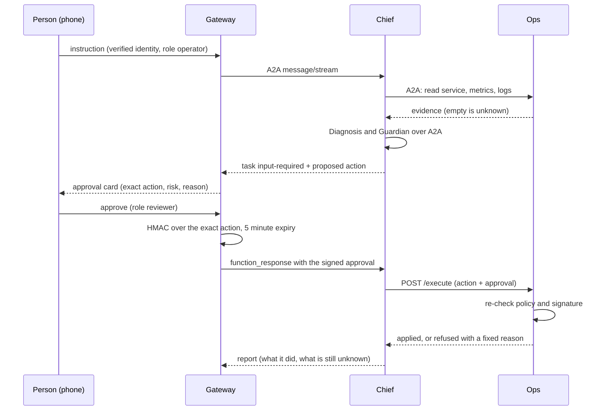

# Architecture

## Components

| Component | Runtime | Responsibility | Identity |
| --- | --- | --- | --- |
| Console (web) | Browser, `@material/web` | Dashboard, assistant panel, approval card | Firebase Google sign-in |
| Android app | Kotlin, Compose Material 3 | Same review flows on a phone | Firebase Google sign-in |
| Gateway | Cloud Run, TypeScript | Verifies the person, owns tasks and approvals, signs approvals, streams from the Chief | `gateway` service account |
| Chief agent | Cloud Run, ADK | Plans, delegates over A2A, asks for decisions | `agent-chief` |
| Ops agent | Cloud Run, ADK + one deterministic endpoint | Reads Cloud Run, Monitoring, Logging; applies an approved rollback | `agent-ops` |
| Diagnosis agent | Cloud Run, ADK | Evidence to hypotheses and unknowns | `agent-diagnosis` |
| Guardian agent | Cloud Run, ADK | Explains policy verdicts | `agent-guardian` |
| Store | Firestore | Tasks, approvals, memberships, audit | Gateway only |

All four agent services are private. Callers present a Google-signed identity token for the callee, and only the intended caller has `run.invoker`.

## The approval sequence

## Trust boundaries

1. **Person to gateway.** The identity, owner, workspace and roles come from the verified Firebase token and the stored membership. Nothing the client sends selects them.
2. **Gateway to Chief.** Authenticated service-to-service. The gateway never sends credentials, only the person's instruction and, later, a signed approval.
3. **Chief to Ops.** Authenticated. The Chief has no Google API permission of its own beyond calling Gemini and its peers.
4. **Ops to Google.** The Ops service account may read the project's Cloud Run, Monitoring and Logging data and may update **one named Cloud Run service**, acting only as that service's own runtime account.
5. **Model output to action.** The model proposes. A deterministic policy and a signature decide. Approval covers one action digest, one actor and five minutes.

## Failure behavior

| Situation | Result |
| --- | --- |
| Metrics or logs are empty | Reported as unknown; never zero or healthy |
| Log text contains instructions | Treated as data; evaluated in the injection scenario |
| Approval expired, forged, for a different action, or missing | Nothing is applied |
| Chief unreachable after an approval was sent | Task shows `unknown`; the approval is not resent |
| Worker goes silent | Task shows `unknown` after three minutes |
| Model quota error (429) | Retried with exponential backoff, because a model call only reads |

## Observability

Each agent service exports OpenTelemetry traces to Cloud Trace (`OPS_TRACE_TO_CLOUD=1`). The gateway keeps a bounded step list per task (agent, call, result, summary) that the console shows as a timeline, and Ops writes one audit line per applied or refused change.

## How the safety claims are checked

- `agents/tests/test_execute_endpoint.py` attacks the Ops `/execute` endpoint over HTTP: malformed bodies, other actions (delete, IAM), no approval, a wrong signing key, a tampered actor or expiry, an expired approval, an approval for another revision or service, and an unregistered service. In every case Cloud Run receives no change request.
- `agents/tests/test_chief_gate.py` drives the Chief with a scripted model: a change pauses for a person, a rejection never reaches Cloud Run, and "the person said yes" without a valid signature changes nothing.
- On the deployed Ops service, a call with no credentials and a call with the gateway's identity (which holds no invoker role there) are both refused by Cloud Run before any code runs. Only the Chief's service account may invoke Ops.
- `agents/evals` runs the real crew on six scenarios; see [EVALUATION.md](EVALUATION.md).

Known limit: an approval is bound to one action, one approver and a five-minute window, not to a single use. Presenting it twice inside the window can only repeat the same rollback to the same revision.

## What is deliberately out of scope

Deleting resources, changing IAM, changing a service account, and any change other than a traffic rollback are refused by the policy table and have no tool.
