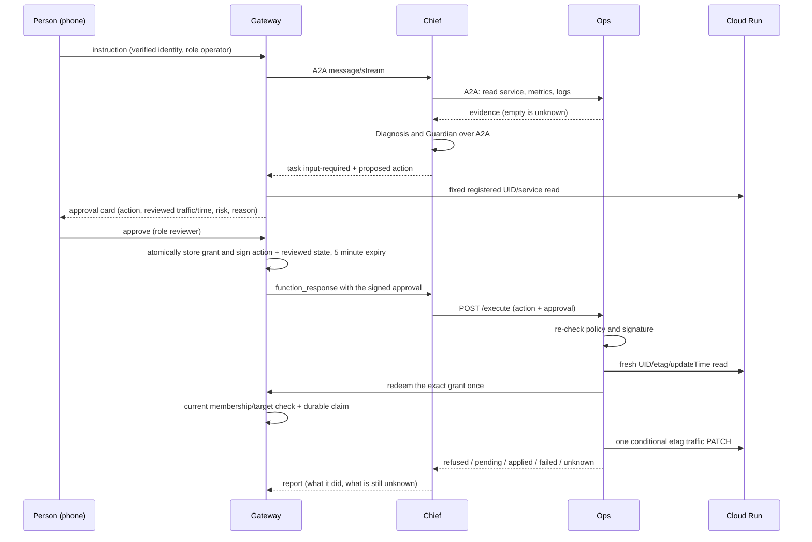

# Architecture

Current source includes the 15 October V2 approval protocol and simulated mobility domains; these changes are not deployed. Historical live runs used V1. Detailed configuration, evidence and limits: [APPROVALS](APPROVALS.md), [Maps](MAPS.md), [STATUS](STATUS.md).

## Components

| Component | Code | Runtime | Responsibility | Identity |
| --- | --- | --- | --- | --- |
| Console (web) | `apps/web` | Browser, `@material/web` | Dashboard, left navigation, right-hand assistant, approval card | Firebase Google sign-in |
| Android app | `apps/android` | Kotlin, Compose Material 3 | Same review flows on a phone | Firebase Google sign-in |
| Gateway | `apps/gateway` | Cloud Run, TypeScript | Verifies the person, owns tasks and approvals, signs approvals, streams from the Chief | `gateway` service account |
| Chief agent | `apps/crew` | Cloud Run, ADK | Plans, delegates over A2A, asks for decisions | `agent-chief` |
| Ops agent | `apps/crew` | Cloud Run, ADK + one deterministic endpoint | Reads Cloud Run, Monitoring, Logging; applies an approved rollback | `agent-ops` |
| Diagnosis agent | `apps/crew` | Cloud Run, ADK | Evidence to hypotheses and unknowns | `agent-diagnosis` |
| Guardian agent | `apps/crew` | Cloud Run, ADK | Explains policy verdicts | `agent-guardian` |
| Store | `apps/gateway/src/store` | Firestore | Tasks, approvals, memberships, audit | Gateway only |
| Contracts | `packages/contracts` | Build time | Schemas and types shared by the web, the gateway and the Android fixtures | none |

The four agents are one Python image started with a different `AGENT` setting. The web console and the gateway ship together as one Cloud Run service.

All four agent services are private. Callers present a Google-signed identity token for the callee, and only the intended caller has `run.invoker`.

## The approval sequence

## Trust boundaries

1. **Person to gateway.** The identity, owner, workspace and roles come from the verified Firebase token and the stored membership. Nothing the client sends selects them. Starting a crew task, deciding one and reading the overview additionally require that the person owns a registered service (`crew_not_entitled` otherwise), so a bare Google sign-in reaches nothing.
2. **Gateway to Chief.** Authenticated service-to-service. The gateway never sends credentials, only the person's instruction and, later, a signed approval.
3. **Chief to Ops.** Authenticated. The Chief has no Google API permission of its own beyond calling Gemini and its peers.
4. **Ops to Google.** The Ops service account may read the project's Cloud Run, Monitoring and Logging data and may update **one named Cloud Run service**, acting only as that service's own runtime account.
5. **Model output to action.** The model proposes. Deterministic policy, explicit owner/UID/destination registration and a human-issued V2 grant authorize execution. Approval covers one action, actor, five-minute lease and reviewed state. A durable gateway claim precedes one conditional PATCH. Unknown outcomes never resend.

## Failure behavior

| Situation | Result |
| --- | --- |
| Metrics or logs are empty | Reported as unknown; never zero or healthy |
| Log text contains instructions | Treated as data; evaluated in the injection scenario |
| Approval expired, forged, for a different action, or missing | Nothing is applied |
| Chief unreachable after an approval was sent | Task shows `unknown`; the approval is not resent |
| Worker goes silent | Task shows `unknown` after three minutes |
| Model quota error (429) | Retried with exponential backoff, because a model call only reads |

## Observability

Each agent service exports OpenTelemetry traces to Cloud Trace (`OPS_TRACE_TO_CLOUD=1`). The gateway keeps a bounded step list per task (agent, call, result, summary) that the console shows as a timeline, and Ops writes one audit line per applied or refused change.

## How the safety claims are checked

- `apps/crew/tests/test_execute_endpoint.py` attacks the Ops `/execute` endpoint over HTTP: malformed bodies, other actions (delete, IAM), no approval, a wrong signing key, a tampered actor or expiry, an expired approval, an approval for another revision or service, and an unregistered service. In every case Cloud Run receives no change request.
- `apps/crew/tests/test_chief_gate.py` drives the Chief with a scripted model: a change pauses for a person, a rejection never reaches Cloud Run, and "the person said yes" without a valid signature changes nothing.
- On the deployed Ops service, a call with no credentials and a call with the gateway's identity (which holds no invoker role there) are both refused by Cloud Run before any code runs. Only the Chief's service account may invoke Ops.
- `apps/crew/evals` runs the real crew on six scenarios; see [EVALUATION.md](EVALUATION.md).

### Execution states and approval freshness

`/execute` answers with exactly one `status`. `refused` (HTTP 403): policy, signature, expiry, a reused approval or a changed service; no change request was sent. `pending` (202): Cloud Run accepted the change and had not finished it within the bounded wait; the report says it is in progress and the Chief reads the traffic split once. `applied` (200): the operation finished and the re-read traffic shows 100% on the approved revision. `failed` (502): Cloud Run did not take the change or the operation ended in an error. `unknown` (504 or no answer): the request may have been delivered; nothing is resent and the person is told the outcome is unknown. A 403 is never used for work that may be running.

V2 source binds the grant to the state shown on the approval card. Ops compares reviewed UID, etag and update time, redeems a private gateway grant once, checks expiry and sends the etag with the one PATCH. Revoked or changed organization membership refuses redemption. Missing broker configuration disables mutation. No Firestore/IAM permission is added to Ops.

Local concurrency/state-drift/HTTP tests pass, and isolated live Firestore contention has one winner. V2 is not deployed. Real read/PATCH conflict rejection is not proved by `validateOnly` (both fresh/modified etag requests returned 200 with unchanged service). Firebase identity is delegated for a bounded lease, not continuously reverified after issuance. See [APPROVALS](APPROVALS.md). The older deployment still uses V1's per-instance ledger and post-tap timestamp check.

## What is deliberately out of scope

Deleting resources, changing IAM, changing a service account, and any change other than a traffic rollback are refused by the policy table and have no tool.
